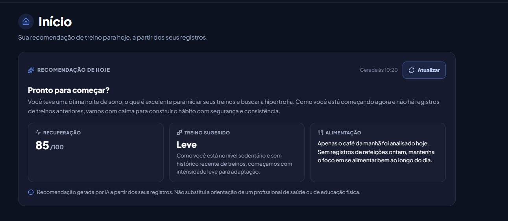
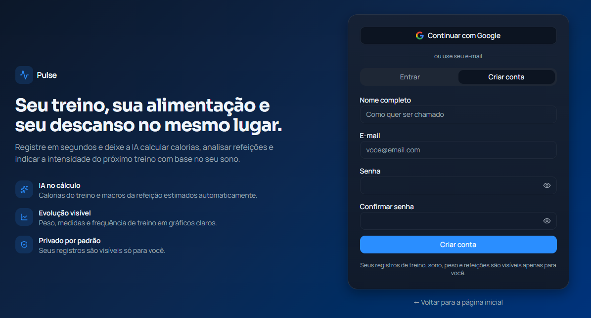
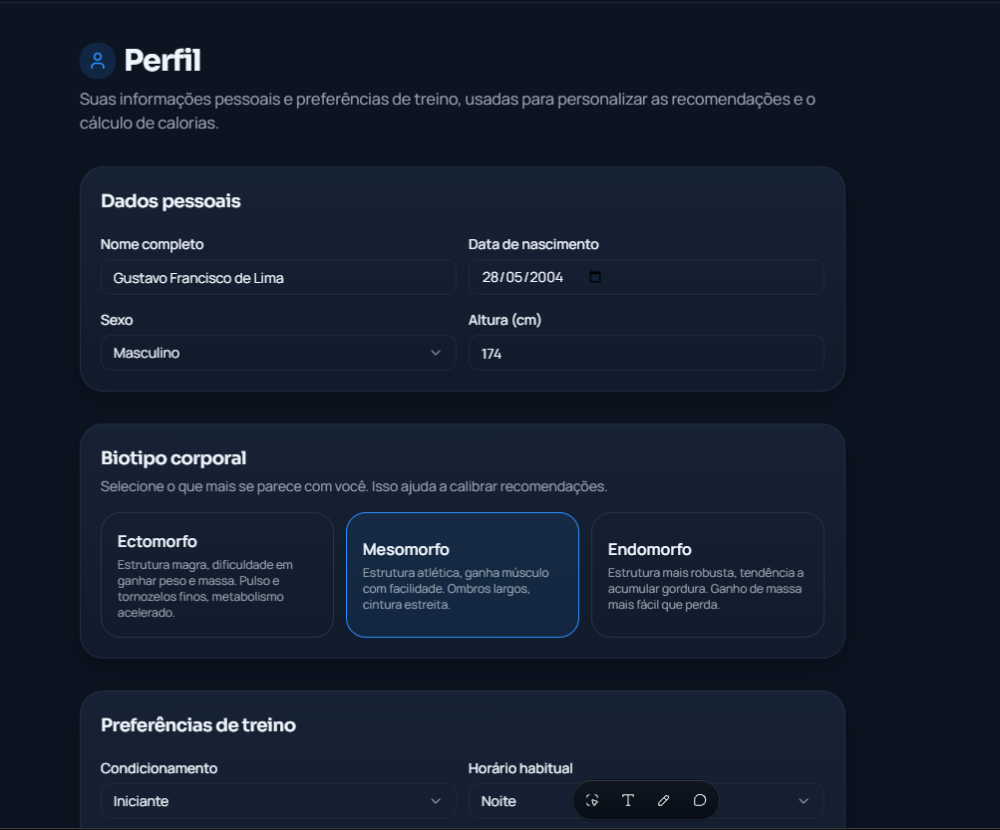
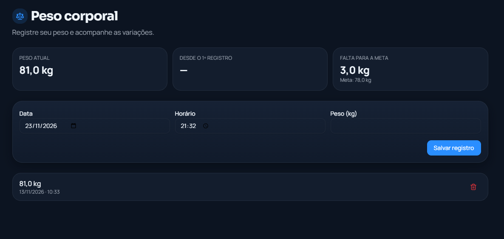
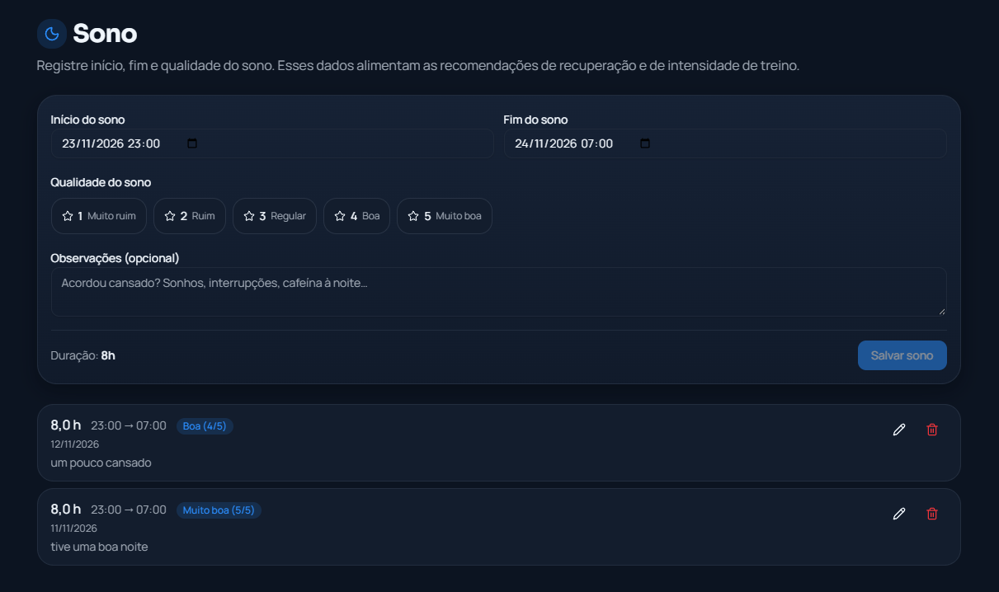
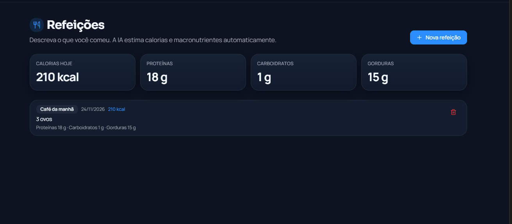
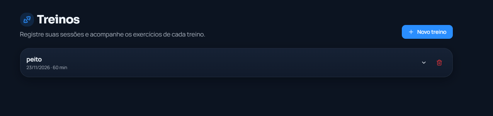
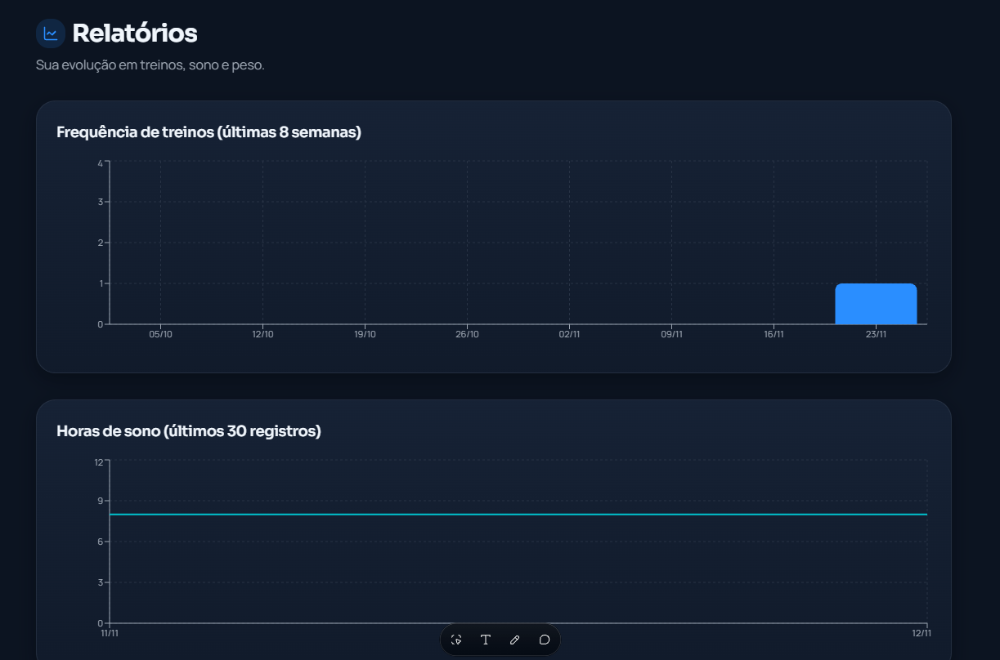

# Pulse 💪

> Registre seus treinos, refeições, sono e evolução de peso em um só lugar e receba dicas diárias de uma IA.



---

## Sumário

1. [Apresentação](#1-apresentação)
2. [Acesso ao aplicativo](#2-acesso-ao-aplicativo)
3. [Perfis de usuário](#3-perfis-de-usuário)
4. [Funcionalidades](#4-funcionalidades)
5. [Manual de utilização](#5-manual-de-utilização)
6. [Exemplos de utilização](#6-exemplos-de-utilização)
7. [Limitações conhecidas](#7-limitações-conhecidas)

---

## 1. Apresentação

**Pulse** é um aplicativo web que ajuda você a melhorar a alimentação e a acompanhar sua rotina de treinos de forma simples e organizada.

### Problema que resolve

Muitas pessoas que treinam não registram seus treinos e informações. Algumas usam o bloco de notas, onde os dados se perdem com facilidade, e outras apenas confiam na memória. Sem histórico, fica difícil medir a evolução e ajustar a rotina.

### Como o Pulse ajuda

Com uma interface simples e objetiva, o Pulse permite registrar:

- Treinos
- Refeições
- Sono
- Evolução de peso

Além disso, a **inteligência artificial** do Pulse analisa seus treinos, refeições e sono e indica como você deve treinar no dia: **leve**, **moderado** ou **intenso**.

### Público-alvo

Pessoas que treinam (iniciantes ou experientes) e querem acompanhar sua evolução e treinar de forma mais inteligente, sem complicação.

---

## 2. Acesso ao aplicativo

Nesta versão, o Pulse **roda localmente**: ainda não há uma versão publicada na internet. Depois de iniciar o projeto, o endereço de acesso é:

**`http://localhost:3000`**

### Como executar o projeto

**Pré-requisitos:** [Python](https://www.python.org) instalado e o código do projeto, disponível em [github.com/licciardicarol/Pulse-Projeto](https://github.com/licciardicarol/Pulse-Projeto).

```bash
# 1. Baixe o projeto
git clone https://github.com/licciardicarol/Pulse-Projeto.git
cd Pulse-Projeto

# 2. Crie e ative um ambiente virtual (Windows)
python -m venv .venv
.venv\Scripts\activate
# No Linux ou macOS: source .venv/bin/activate

# 3. Instale as dependências
pip install -r requirements.txt

# 4. Inicie o aplicativo
reflex run
```

Com o projeto em execução, abra o navegador em `http://localhost:3000`.

### Navegação

Após entrar, a navegação é feita pelo menu superior:

**Início · Treinos · Refeições · Sono · Peso · Relatórios · Perfil**

> O app possui apenas **login de usuário**. O perfil de Suporte não tem acesso pela interface (veja a seção 3).
>
> **Precisa de ajuda?** Escreva para **suporte.pulse@gmail.com**.

---

## 3. Perfis de usuário

O Pulse possui dois perfis, cada um com permissões e responsabilidades diferentes. Apenas o **Usuário** acessa o aplicativo pelo login. O **Suporte** é a equipe de manutenção, que atua nos bastidores.

| | **Usuário** | **Suporte** |
|---|---|---|
| **Quem é** | Pessoa que usa o Pulse para acompanhar treinos, alimentação, sono e peso | Equipe responsável por atender e orientar os usuários |
| **Acesso** | Login no aplicativo; apenas aos próprios registros | Sem login no app; acessa o código-fonte e o ambiente de hospedagem do projeto |
| **Objetivo** | Acompanhar sua evolução e receber dicas da IA | Garantir que o app funcione bem e que o usuário tenha uma boa experiência |

### 👤 Usuário

**O que pode fazer**

- Registrar e consultar seus treinos, refeições, sono e evolução de peso
- Receber a recomendação diária da IA (treino leve, moderado ou intenso)
- Editar seus dados pessoais, biotipo e preferências de treino na tela **Perfil**

**O que não pode fazer**

- Ver ou alterar dados de outros usuários
- Acessar as ferramentas de suporte

**Responsabilidades**

- Manter o perfil (altura, biotipo, condicionamento, objetivo) e o peso atualizados, pois a IA usa essas informações para entender o que você deseja alcançar
- Registrar treinos, refeições e sono com regularidade: quanto mais completo o histórico, mais precisa é a recomendação

### 🛠️ Suporte

O Suporte é a equipe responsável pela manutenção do Pulse. Ele não possui login nem telas dentro do app.

**O que pode fazer**

- Acessar o código-fonte e o ambiente de hospedagem do projeto
- Realizar testes no aplicativo, com contas de teste, para identificar falhas
- Analisar, corrigir e publicar correções para os problemas reportados pelos usuários
- Orientar os usuários no uso das funcionalidades
- Atender os usuários pelo e-mail **suporte.pulse@gmail.com**

**O que não pode fazer**

- Consultar ou alterar os registros pessoais dos usuários sem autorização
- Acessar o app como usuário, pois não há login de suporte

**Responsabilidades**

- Investigar e resolver os problemas relatados com agilidade
- Garantir uma navegação simples e agradável para quem usa o app
- Tratar os dados dos usuários com sigilo

---

## 4. Funcionalidades

O Pulse reúne em um só lugar o registro da sua rotina de treinos, alimentação, sono e evolução corporal. Veja o que cada área oferece:

### 👤 Perfil

Reúne as informações que a IA usa para calibrar as análises e recomendações.

- **Dados pessoais:** nome completo, data de nascimento, sexo e altura (cm)
- **Biotipo corporal:** ectomorfo, mesomorfo ou endomorfo
- **Preferências de treino:** condicionamento (ex.: iniciante), horário habitual, meta semanal de treinos, objetivo (ex.: hipertrofia) e modalidades favoritas (musculação, cardio, funcional, CrossFit, luta, yoga, pilates e esportes de areia)

### 🍽️ Refeições

Registre as refeições que fizer ao longo do dia.

- Informe a **data**, escolha o **tipo** da refeição (ex.: almoço, jantar) e descreva em texto livre o que comeu (ex.: "250g de arroz, 100g de feijão e bife").
- A IA estima as **calorias, proteínas, carboidratos e gorduras** de cada refeição, e o registro recebe a etiqueta **Estimado por IA**.
- Os cartões no topo da tela mostram o **resumo total do dia** (calorias, proteínas, carboidratos e gorduras).
- O **histórico** lista todas as refeições registradas.

### 😴 Sono

Registre como foi a sua noite de sono.

- **Início e fim do sono:** data e hora (horário de Brasília). A **duração** é calculada automaticamente.
- **Qualidade:** nota de 1 (muito ruim) a 5 (muito bom).
- **Observações (opcional):** relate o que aconteceu durante a noite (ex.: pesadelos, despertares, cafeína à noite), com até 500 caracteres.
- Essas informações ajudam a IA a entender como está a sua recuperação.

### 🏋️ Treinos

Registre o treino realizado no dia.

- **Data** e **duração** (em minutos)
- **Nome** do treino (ex.: peito e tríceps)
- **Categoria** (ex.: musculação, corrida)
- **Intensidade** (leve, moderada ou alta)
- **Observações** sobre como foi a experiência (ex.: disposição, dificuldade, dores)

### ⚖️ Peso

Acompanhe a variação do seu peso corporal.

- Registre **data, horário e peso (kg)**.
- Cartões no topo mostram o **peso atual** e a variação **desde o 1º registro**.
- O cartão **Falta para a meta** ainda está em desenvolvimento ("Disponível em breve").
- O **histórico** lista todos os registros.

### 🤖 Recomendação da IA

Na tela **Início**, a IA analisa seus **treinos, refeições e sono** e entrega um resumo para você decidir como treinar hoje. A recomendação mostra o horário em que foi gerada e pode ser recalculada no botão **Atualizar**.

**O que você recebe**

| Indicador | O que significa |
|---|---|
| **Recuperação (0 a 100)** | Mostra o quanto o seu corpo está descansado e pronto para treinar. Quanto maior a nota, melhor a recuperação. |
| **Alimentação** | Avalia se o que você consumiu (calorias, proteínas, carboidratos e gorduras) está adequado para o seu treino. |
| **Treino sugerido** | Indica como treinar hoje: leve, moderado ou intenso, com a justificativa. |

Além dos indicadores, o cartão traz uma mensagem de orientação personalizada.

**Intensidade recomendada**

- **Leve:** recuperação baixa. Priorize descanso, alongamento ou uma atividade tranquila.
- **Moderado:** recuperação razoável. Treine, mas sem forçar além do normal.
- **Intenso:** recuperação alta. Bom dia para treinos mais pesados ou desafiadores.

> 💡 Quanto mais completos forem seus registros, mais precisa é a recomendação. Sem registros de sono e refeições, a IA tende a sugerir um treino leve por cautela.

> ⚠️ As recomendações da IA são orientações gerais e não substituem o acompanhamento de um profissional de saúde ou de educação física.

### 📊 Relatórios

A aba **Relatórios** mostra a sua evolução em treinos, sono e peso por meio de gráficos:

- **Frequência de treinos:** últimas 8 semanas
- **Horas de sono:** últimos 30 registros
- **Peso:** evolução dos registros de peso

Enquanto não houver registros suficientes, o gráfico exibe a mensagem "Ainda não há dados suficientes".

### 🛠️ Suporte

O perfil de Suporte não possui funcionalidades dentro do aplicativo. Ele atua nos bastidores, na manutenção e na correção de problemas (veja a seção 3).

---

## 5. Manual de utilização

### 👤 Perfil Usuário

#### Primeiro acesso

**1. Crie sua conta**

Com o projeto em execução, acesse `http://localhost:3000`. Na tela inicial, escolha uma das opções:

- **Continuar com Google:** entra com a sua conta Google, sem precisar criar senha.
- **Criar conta com e-mail:** na aba **Criar conta**, informe **nome completo**, **e-mail**, **senha** e **confirmação da senha**, e clique em **Criar conta**.

Nos próximos acessos, use a aba **Entrar**. Seus registros de treino, sono, peso e refeições ficam visíveis apenas para você.



**2. Preencha o seu perfil**

> ⚠️ **Antes de usar o app, preencha o seu perfil.** Ele é usado pela IA para calibrar a análise das refeições e a recomendação de treino.

Acesse **Perfil** no menu superior e preencha as três seções:

- **Dados pessoais:** nome completo, data de nascimento, sexo e altura (cm)
- **Biotipo corporal:** escolha o que mais se parece com você (ectomorfo, mesomorfo ou endomorfo)
- **Preferências de treino:** condicionamento, horário habitual, meta semanal de treinos, objetivo e modalidades favoritas

Depois, clique em **Salvar perfil**.



> O peso é registrado na aba **Peso** (passo 3).

**3. Registre o seu peso**

Acesse a aba **Peso**, confira a data e o horário, informe o peso em kg e clique em **Salvar registro**.



**4. Registre o seu sono**

Acesse a aba **Sono** e informe como foi a sua última noite:

- Início e fim do sono
- Qualidade, com nota de 1 a 5
- Observações (opcional), como pesadelos ou despertares

Clique em **Salvar sono**.



**5. Registre suas refeições**

Acesse a aba **Refeições**, clique em **Nova refeição**, confira a data, escolha o tipo (ex.: almoço) e descreva o que comeu. Clique em **Salvar e analisar**. A IA calcula as calorias, proteínas, carboidratos e gorduras da refeição, e os cartões do topo mostram o total do dia.



**6. Registre o seu treino**

Acesse a aba **Treinos**, clique em **Novo treino** e informe:

- Data e duração (em minutos)
- Nome e categoria do treino
- Intensidade (leve, moderada ou alta)
- Observações sobre como foi a experiência

Clique em **Salvar treino**.



**7. Veja a recomendação da IA**

Com seus registros salvos, acesse **Início** para ver a recuperação (0 a 100), a avaliação da alimentação e o treino sugerido para hoje: leve, moderado ou intenso. Se registrar algo novo, clique em **Atualizar** para recalcular.


#### Uso diário

Para manter a recomendação precisa, repita todos os dias:

1. Registre o sono da noite anterior
2. Registre as refeições ao longo do dia
3. Registre o treino
4. Consulte a recomendação da IA na tela **Início**

#### Acompanhando sua evolução

Acesse a aba **Relatórios** para ver gráficos da frequência de treinos (últimas 8 semanas), das horas de sono (últimos 30 registros) e da evolução do peso. Quanto mais registros, mais completos ficam os gráficos. Enquanto faltarem dados, a aba exibe "Ainda não há dados suficientes".



### 🛠️ Perfil Suporte

O Suporte não usa o aplicativo por login. O atendimento acontece nos bastidores:

1. **Receber o problema:** o usuário relata a falha pelo e-mail **suporte.pulse@gmail.com**.
2. **Reproduzir:** a equipe tenta repetir o problema no app usando uma conta de teste, sem acessar dados reais do usuário.
3. **Corrigir:** o ajuste é feito no código-fonte do projeto, no repositório.
4. **Publicar e conferir:** a correção é publicada e testada no app em funcionamento.
5. **Responder ao usuário:** a equipe informa que o problema foi resolvido.

---

## 6. Exemplos de utilização

Os exemplos abaixo mostram um dia de uso do Pulse, do perfil até a recomendação da IA. Todos os dados são fictícios e podem ser usados para testar o aplicativo.

### 6.1 Dados de demonstração

| Tipo     | Registro                                                                           |
|----------|------------------------------------------------------------------------------------|
| Perfil   | João Silva, masculino, 178 cm, mesomorfo, iniciante, objetivo hipertrofia, 4 treinos por semana, musculação |
| Treino   | Peito e tríceps, 01/11/2026, 60 min, categoria musculação, intensidade moderada              |
| Refeição | Jantar: 250g de arroz, 100g de feijão e bife (621 kcal)                            |
| Sono     | 20/11/2026 23:00 até 21/11/2026 06:30 (7h30), qualidade 4 · Bom                    |
| Peso     | 65,0 kg em 21/11/2026 às 07:30                                                     |

### 6.2 Preencher o perfil

1. Faça login e acesse **Perfil** no menu superior.
2. Preencha as seções:

| Seção                   | Campo                  | Exemplo                               |
|-------------------------|------------------------|---------------------------------------|
| Dados pessoais          | Nome completo          | João Silva                            |
|                         | Data de nascimento     | 15/03/2000                            |
|                         | Sexo                   | Masculino                             |
|                         | Altura (cm)            | 178                                   |
| Biotipo corporal        | Biotipo                | Mesomorfo                             |
| Preferências de treino  | Condicionamento        | Iniciante                             |
|                         | Horário habitual       | Manhã                                 |
|                         | Meta semanal (treinos) | 4                                     |
|                         | Objetivo               | Hipertrofia (ganho de massa muscular) |
|                         | Modalidades favoritas  | Musculação                            |

3. Clique em **Salvar perfil**.


### 6.3 Registrar um treino

1. Acesse **Treinos** e clique em **Novo treino**.
2. Preencha:

| Campo       | Exemplo         |
|-------------|-----------------|
| Data        | 01/11/2026      |
| Duração     | 60 min          |
| Nome        | Peito e tríceps |
| Categoria   | Musculação      |
| Intensidade | Moderada        |
| Observações | Bem             |

3. Clique em **Salvar treino**. O treino aparece na lista com data, duração e as etiquetas de categoria e intensidade. Para removê-lo, use o ícone de lixeira.


### 6.4 Registrar uma refeição (análise da IA)

1. Acesse **Refeições** e clique em **Nova refeição**.
2. Confira a data, escolha o tipo da refeição (**Jantar**) e descreva o que comeu:

   > 250g de arroz, 100g de feijão e bife

3. Clique em **Salvar e analisar**. A IA estima as calorias e os macronutrientes.

**Resultado esperado** (no **Histórico**):

| Item                   | Calorias     |
|------------------------|--------------|
| 250 g de arroz         | ~325 kcal    |
| 100 g de feijão        | ~76 kcal     |
| 1 bife de carne bovina | ~220 kcal    |
| **Total da refeição**  | **621 kcal** |

Macronutrientes da refeição: **Proteínas 38,5 g · Carboidratos 85,2 g · Gorduras 12,4 g**.

Os cartões **Calorias hoje, Proteínas, Carboidratos e Gorduras**, no topo da tela, somam apenas o consumo do dia atual. Por isso ficam zerados enquanto não houver refeições registradas na data de hoje.

> ⚠️ Os valores são estimados por IA a partir da descrição e não substituem a orientação de um nutricionista.


### 6.5 Registrar sono

1. Acesse **Sono**. O formulário **Novo registro** já vem aberto.
2. Preencha (datas e horas no horário de Brasília):

| Campo                  | Exemplo            |
|------------------------|--------------------|
| Início do sono         | 20/11/2026 23:00   |
| Fim do sono            | 21/11/2026 06:30   |
| Qualidade do sono      | 4 · Bom            |
| Observações (opcional) | Acordei descansado |

3. O campo **Duração** é calculado automaticamente (**7h30** no exemplo).
4. Clique em **Salvar sono**.


### 6.6 Registrar peso

1. Acesse **Peso**.
2. Em **Novo registro**, informe:

| Campo     | Exemplo    |
|-----------|------------|
| Data      | 21/11/2026 |
| Horário   | 07:30      |
| Peso (kg) | 65,0       |

3. Clique em **Salvar registro**. O valor entra no **Histórico** e os cartões **Peso atual** e **Desde o 1º registro** são atualizados.


### 6.7 Receber a recomendação de treino do dia

Na tela **Início**, a IA cruza perfil, treinos, refeições e sono e indica a intensidade do treino.

**Exemplo 1: sem registros de sono e refeição (perfil iniciante)**

- **Mensagem:** "Vamos iniciar seus treinos com calma!", orientando a começar com cautela, focar em aprender os movimentos e ouvir o corpo.
- **Recuperação:** 50/100
- **Treino sugerido:** **Leve**, pois faltam dados de sono e nutrição.
- **Alimentação:** nenhuma refeição registrada para análise.


**Exemplo 2: cenários ilustrativos**

Os valores abaixo são ilustrativos e mostram como os registros influenciam a indicação:

| Cenário                      | Sono | Treino recente        | Alimentação    | Indicação esperada |
|------------------------------|------|-----------------------|----------------|--------------------|
| Sem registros                | —    | —                     | —              | **Leve**           |
| Descansado e bem alimentado  | 8 h  | 1 dia de descanso     | Dentro da meta | **Intenso**        |
| Rotina equilibrada           | 7 h  | Treino moderado ontem | Dentro da meta | **Moderado**       |
| Sono ruim e carga alta ontem | 5 h  | Treino longo ontem    | Adequada       | **Leve**           |

Depois de cadastrar novos registros, clique em **Atualizar** para recalcular a recomendação.

> ⚠️ A recomendação é gerada por IA e não substitui a orientação de um profissional de saúde ou de educação física.

---

## 7. Limitações conhecidas

Esta é a versão inicial do Pulse. Abaixo estão as restrições conhecidas e o que está previsto para as próximas versões.

### 7.1 Funcionalidades em desenvolvimento

| Funcionalidade | Situação |
|----------------|----------|
| **Meta de peso** | O cartão "Falta para a meta", na tela **Peso**, ainda não está disponível e aparece como "Disponível em breve". |

### 7.2 Limitações da IA

- **Valores nutricionais são estimativas.** A IA calcula calorias, proteínas, carboidratos e gorduras a partir da descrição em texto, então o resultado pode variar conforme porções, modo de preparo e marcas dos alimentos. Quanto mais detalhada a descrição (quantidades em gramas, por exemplo), mais próxima da realidade tende a ser a estimativa.
- **A recomendação de treino depende dos registros.** Sem dados de sono e refeições, a IA sugere um treino **leve** por cautela. A recomendação só fica mais precisa com um histórico completo.
- **A recomendação não é atualizada automaticamente.** Depois de novos registros, é preciso clicar em **Atualizar** na tela **Início** para recalculá-la.
- **A IA não substitui profissionais.** As análises e recomendações são orientações gerais e não substituem o acompanhamento de nutricionistas, educadores físicos ou médicos.
- **Respostas podem variar.** Como a análise é gerada por IA, o mesmo registro pode produzir textos ou valores ligeiramente diferentes em consultas distintas.

### 7.3 Restrições de uso

- **Resumo diário de refeições:** os cartões do topo da tela **Refeições** consideram apenas o dia atual. Refeições registradas em outras datas aparecem somente no histórico e não entram no total de hoje.
- **Horário fixo:** os registros de sono usam o horário de Brasília, e o dia vira à meia-noite (00:00). Usuários em outros fusos devem ajustar os horários manualmente.
- **Edição de registros:** treinos, refeições e pesos não podem ser editados. Para corrigir um deles, é preciso excluir o registro e criá-lo novamente. Somente os registros de sono podem ser editados.
- **Exclusão de registros:** treinos, refeições, sono e pesos podem ser excluídos.
- **Observações do sono:** o campo aceita até 500 caracteres.
- **Peso no perfil:** o peso não faz parte do **Perfil**. Ele é registrado apenas na tela **Peso**.

### 7.4 Limitações da versão entregue

- **Execução local:** o Pulse ainda não está publicado na internet e precisa ser executado localmente para ser usado.
- **Somente navegador:** o Pulse funciona apenas pelo navegador. Um aplicativo para celular está previsto para versões futuras.
- **Conexão com a internet:** as análises da IA exigem conexão ativa.
- **Sem integração com dispositivos:** os dados de sono, treino e peso são digitados manualmente, sem sincronização com relógios inteligentes ou balanças.
- **Idioma:** a interface está disponível apenas em português.
- **Perfil Suporte:** não há login de suporte, painel administrativo nem canal de atendimento dentro do app. O atendimento é feito pela equipe de desenvolvimento, fora da interface, pelo e-mail suporte.pulse@gmail.com.
- **Relatórios:** os gráficos usam períodos fixos (últimas 8 semanas e últimos 30 registros), sem filtro por período nem exportação. Cada gráfico só é exibido depois que há dados suficientes.

### 7.5 Próximos passos

Melhorias previstas para versões futuras:

- Meta de peso com acompanhamento do progresso
- Edição de treinos, refeições e pesos
- Aplicativo para celular
- Filtros por período e exportação dos relatórios
- Integração com dispositivos de monitoramento
