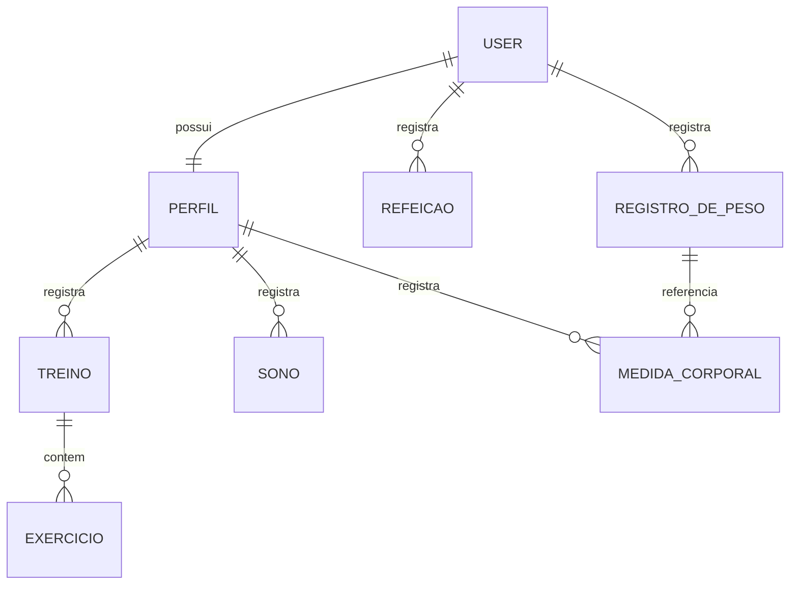

# Domain Model — Pulse

## Purpose
O Pulse é um aplicativo de acompanhamento de rotina e evolução física. Ele
centraliza dados de treinos, exercícios, alimentação, sono, peso e medidas
corporais de um usuário, permitindo acompanhar progresso ao longo do tempo.

Este documento reflete o schema do banco de dados do Pulse (ver
`create-tables.sql`), servindo de referência para os specs de capability
(ex.: `treinos/`, `refeicoes/`, `sono/`) e para o agente de IA que vai
implementar o sistema sobre esse schema.

> Nota: entidades marcadas como "planejadas" no `project-overview.md`
> (ex.: `UserGoal`/`user_goals`) NÃO devem ser tratadas como existentes até
> confirmação explícita de implementação, conforme regra do AGENTS.md.

## Core Concepts (Entities & Value Objects)

### Requirement: Usuário (User)
O sistema DEVE definir uma entidade `User` (tabela `user` do Xano, com
autenticação habilitada) contendo:
- id: identificador único
- nome: string
- email: string única (normalizada: sem espaços nas pontas, minúsculas)
- senha: hash (tipo password do Xano); nunca é retornada pela API

#### Scenario: Cadastro de conta
- **Given** uma pessoa informa nome, e-mail e senha (mínimo de 8 caracteres)
- **When** o Xano cria a conta
- **Then** o sistema devolve um token de sessão e cria o Perfil vinculado

---

### Requirement: Perfil (Profile)
O sistema DEVE definir uma entidade `Perfil` com os dados de personalização
do usuário, contendo:
- id: identificador único
- user_id: referência ao `User` (única — relação 1:1)
- nome: string (até 50 caracteres)
- data_de_nascimento: date (no passado, a partir de 1900)
- sexo: enum (Feminino, Masculino, Outro)
- altura_cm: decimal (100 a 250)
- tipo_fisico: enum (Ectomorfo, Mesomorfo, Endomorfo)
- nivel_fisico: enum (Sedentário, Iniciante, Intermediário, Avançado, Atleta)
- modalidade_fav1: lista de enum (Musculação, Cardio, Funcional, CrossFit,
  Luta, Yoga, Pilates, Esportes de areia) — substitui o antigo `modalidade_fav`
- horario_fav_de_treino: enum (Manhã, Tarde, Noite, Madrugada)
- meta_semanal: inteiro (1 a 14 treinos por semana)
- objetivo: enum (Hipertrofia (ganho de massa muscular), Emagrecimento (perda
  de gordura), Melhorar condicionamento físico, Preservação de saúde mental)
- medidas: boolean (indica se o usuário quer registrar medidas corporais)
- onboarding_concluido: boolean (false no cadastro; true ao salvar o Perfil
  completo pela primeira vez)
- data_atualizacao: datetime — preenchido pelo servidor a cada salvamento

No banco todos os campos acima (exceto `id` e `user_id`) são opcionais, porque
o Perfil nasce vazio no cadastro. Ao salvar pela tela/API, todos passam a ser
obrigatórios (modalidades: pelo menos uma), validados no Reflex e no Xano.

#### Scenario: Criação de perfil
- **Given** um novo usuário se cadastra no Pulse
- **When** o Xano cria a conta
- **Then** um Perfil é criado na mesma operação, vinculado ao `user_id`, com o
  nome do cadastro e `onboarding_concluido = false`

#### Scenario: Conclusão do onboarding
- **Given** um usuário com `onboarding_concluido = false`
- **When** ele salva o Perfil com todos os campos válidos
- **Then** o Perfil é atualizado e `onboarding_concluido` passa a `true`

---

### Requirement: Treino (Workout session)
O sistema DEVE definir uma entidade `Treino` associada a um Perfil,
representando uma sessão de treino, contendo:
- id: identificador único
- profile_id: referência ao Perfil
- categoria: enum (Superior, Inferior, Full body)
- inicio: datetime
- fim: datetime
- intensidade: enum (Leve, Moderada, Intensa) — opcional
- anotacoes: string — opcional
- calorias_estimadas: decimal(5,2) — opcional
- analise_ia: text — opcional (resultado de análise gerada por IA sobre o treino)
- data: date

> Alteração em relação à versão anterior deste documento: carga e
> repetições saem do Treino e passam a pertencer à entidade `Exercicio`
> abaixo, já que um Treino pode conter múltiplos exercícios (conforme
> `project-overview.md`). Confirmar se essa estrutura já existe assim no
> Xano ou se precisa ser criada.

#### Scenario: Registro de treino
- **Given** um usuário inicia uma sessão de treino
- **When** ele registra categoria, início, fim e (opcionalmente) intensidade
  e anotações
- **Then** o sistema salva o Treino vinculado ao seu Perfil

---

### Requirement: Exercício (Exercise)
O sistema DEVE definir uma entidade `Exercicio` associada a um Treino,
contendo:
- id: identificador único
- treino_id: referência ao Treino
- nome_exercicio: string (até 50 caracteres)
- ordem: number (posição do exercício dentro do treino)
- series: number
- repeticoes: number
- carga: decimal — opcional

#### Scenario: Registro de exercício dentro de um treino
- **Given** um usuário está registrando um Treino
- **When** ele adiciona um exercício com nome, ordem, séries, repetições e
  (opcionalmente) carga
- **Then** o sistema salva o Exercicio vinculado ao Treino correspondente

---

### Requirement: Sono (Sleep)
O sistema DEVE definir uma entidade `Sono` associada a um Perfil, contendo:
- id: identificador único
- profile_id: referência ao Perfil
- tipo_sono: enum (Principal, Soneca) — opcional, permite múltiplos
  períodos de sono no mesmo dia
- inicio_sono: datetime
- fim_sono: datetime
- qualidade_sono: enum (Muito ruim, Ruim, Regular, Bom, Muito bom) — opcional
- observacoes: string — opcional

#### Scenario: Registro de sono
- **Given** um usuário quer registrar sua noite de sono
- **When** ele informa horário de início e fim
- **Then** o sistema salva o registro de Sono vinculado ao seu Perfil

#### Scenario: Registro de soneca no mesmo dia
- **Given** um usuário já registrou o sono principal do dia
- **When** ele registra um novo período de sono do tipo "Soneca"
- **Then** o sistema salva um novo registro de Sono, sem sobrescrever o
  registro anterior

---

### Requirement: Refeição (Meal)
O sistema DEVE definir uma entidade `Refeição` (tabela `Refeicoes`) associada
ao usuário, contendo:
- id: identificador único
- user_id: referência ao `User` (dono; preenchido só pelo servidor, a partir
  do token)
- data_refeicao: date (só a data; o período do dia vem do `tipo`; nunca futura)
- tipo: enum (Café da manhã, Almoço, Café da tarde, Jantar) — obrigatório na
  interface
- descricao: text (3 a 500 caracteres) — descrição livre dos alimentos
- calorias: decimal (kcal) — opcional, preenchido apenas pela análise por IA
- proteinas: decimal (g) — opcional, idem
- carboidratos: decimal (g) — opcional, idem
- gorduras: decimal (g) — opcional, idem
- analise_ia: text — opcional; vazio significa "aguardando análise"

> Decisão de 2026-10-21: o Xano devolve decimais vazios como `0`; por isso
> uma refeição só é considerada analisada quando `analise_ia` está
> preenchido, e os totais do dia somam apenas refeições analisadas. O app
> nunca estima nem envia valores nutricionais.

#### Scenario: Registro de refeição
- **Given** um usuário autenticado descreve o que comeu
- **When** ele informa data, tipo e descrição
- **Then** o sistema salva a Refeição vinculada ao seu `user_id`, sem valores
  nutricionais, aguardando análise

---

### Requirement: Registro de Peso (Weight Log)
O sistema DEVE definir uma entidade `RegistroDePeso` (tabela `Registro_Peso`
do Xano) associada ao `User`, contendo:
- id: identificador único
- user_id: referência ao `User` (dono; preenchido só pelo servidor, a partir
  do token) — decisão de 2026-10-23, no lugar do antigo `profile_id`
- peso: decimal(5,2), em kg, de 20 a 400 com no máximo 2 casas decimais
- data_horario: timestamp (guardado em UTC; o app informa e exibe no horário
  de Brasília, UTC−03:00)
- observacoes: string — opcional; planejado, ainda não existe na tabela

> Futuro: o cartão "Falta para a meta" vai exigir um peso-alvo (ex.: campo
> `peso_meta` decimal), que ainda não existe. Até lá, nada é calculado.

#### Scenario: Registro de peso
- **Given** um usuário se pesa
- **When** ele registra o valor e a data/hora
- **Then** o sistema salva um novo RegistroDePeso vinculado ao seu User

---

### Requirement: Medida Corporal (Body Measurement)
> Planejado: ainda não existe tabela de medidas no Xano. O switch "Registrar
> medidas corporais" do Perfil só guarda a preferência (`medidas`) até um
> delta futuro criar a tabela (com dono, `peso_id` opcional e os campos abaixo).

O sistema DEVE definir uma entidade `MedidaCorporal` associada a um
Perfil, e opcionalmente a um RegistroDePeso, contendo:
- id: identificador único
- profile_id: referência ao Perfil
- peso_id: referência ao RegistroDePeso — opcional
- cintura_cm: decimal — opcional
- quadril_cm: decimal — opcional
- peito_cm: decimal — opcional
- braco_cm: decimal — opcional
- coxa_cm: decimal — opcional
- panturrilha_cm: decimal — opcional
- data: date

#### Scenario: Registro de medida corporal vinculada a uma pesagem
- **Given** um usuário acabou de registrar seu peso
- **When** ele opcionalmente informa medidas corporais no mesmo momento
- **Then** o sistema salva a MedidaCorporal referenciando o RegistroDePeso
  correspondente

#### Scenario: Registro de medida corporal isolada
- **Given** um usuário quer registrar medidas corporais sem estar
  necessariamente se pesando
- **When** ele preenche ao menos uma medida
- **Then** o sistema salva a MedidaCorporal vinculada ao Perfil, sem
  referência a um RegistroDePeso

## Relationships

- **User 1:1 Perfil** (via `Perfil.user_id`, único)
- **Perfil 1:N Treino**
- **Treino 1:N Exercicio**
- **Perfil 1:N Sono**
- **User 1:N Refeição** (via `Refeicoes.user_id`)
- **User 1:N RegistroDePeso** (via `Registro_Peso.user_id`)
- **Perfil 1:N MedidaCorporal**
- **RegistroDePeso 1:N MedidaCorporal** (opcional)

## Business Rules / Invariants

- Todo registro (Treino, Sono, MedidaCorporal) DEVE estar vinculado a um
  Perfil existente (`profile_id`); a Refeição e o RegistroDePeso são
  vinculados diretamente ao `User` (`user_id`), por decisões de 2026-10-20 e
  2026-10-23
- Todo `Exercicio` DEVE estar vinculado a um `Treino` existente (`treino_id`)
- `fim` DEVE ser posterior a `inicio` (Treino) e `fim_sono` DEVE ser
  posterior a `inicio_sono` (Sono)
- `peso`, `calorias`, `carga`, `repeticoes`, `series` DEVEM ser valores não negativos
- Cada usuário só pode visualizar e editar seus próprios registros (RLS —
  ver `project-overview.md`, seção "Segurança e regras do banco"). No Xano,
  isso é garantido por endpoints autenticados (`auth = "user"`) que localizam
  o registro sempre pelo `$auth.id` do token — nunca por id enviado pelo
  cliente (ex.: `GET/PATCH perfil/me`). Não existem CRUDs públicos de `user`
  ou `Perfil`.

## Glossary

- **User**: conta de acesso (nome, e-mail e senha) usada na autenticação
- **Perfil**: dados de personalização do usuário dentro do domínio do Pulse
- **Treino**: sessão de treino, que agrupa um ou mais exercícios
- **Exercício**: um exercício individual dentro de um Treino, com suas
  próprias séries, repetições e carga
- **MedidaCorporal**: conjunto de medidas corporais, podendo ou não estar
  vinculado a uma pesagem específica